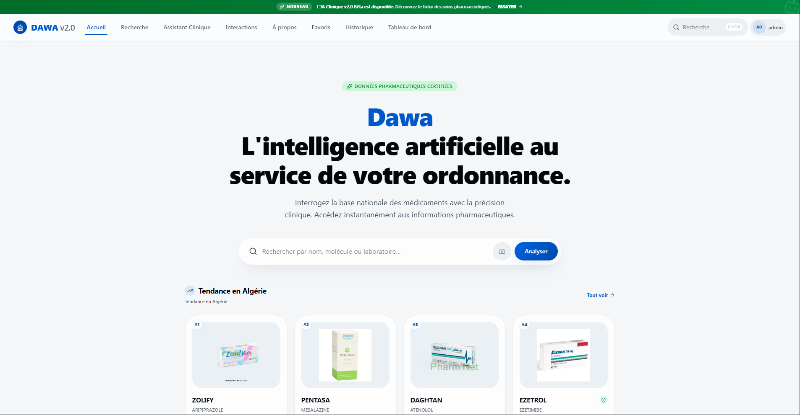
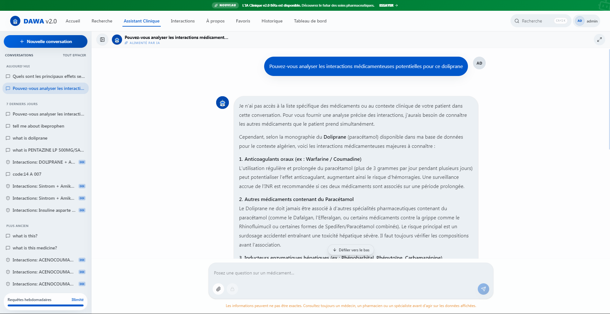

# UI screenshots

This directory can contain approved, sanitized screenshots of the final user interface.

Example README usage:
## Home Page

## AI assistant

## DDI Page

The final UI repository and screenshot files are external to this repository until explicitly approved and published.
